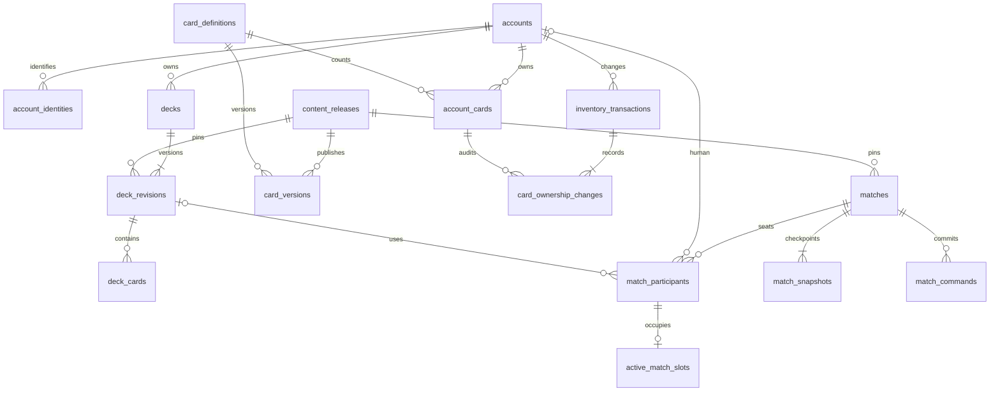

# FrontageのPostgreSQL設計案

作成日: 2026-10-26 / 調査基点: main `f4a62b8`

**PostgreSQL 18を永続データの正とし、対戦の実行状態はGoのメモリで扱う。** 操作が確定した境界で履歴と状態を保存する。既存のメモリRepositoryをすべてSQLへ置換する構成にはしない。

カードはユーザーごとに所持枚数を管理する。デッキ登録・対戦では所持カードを消費せず、main/sub/extra合計の必要枚数を保存時と対戦開始時に検証することを基本案とする。

本書は設計提案。[schema-proposal.sql](schema-proposal.sql)は空の検証DB向けのDDL案で、アプリのマイグレーションではない。[verify-proposal.sql](verify-proposal.sql)で主要な制約を確認する。接続処理やSQLドライバの導入は別の実装作業になる。

`psql`はPostgreSQLの操作クライアントとして扱う。DBエンジンはPostgreSQLを採用し、導入時の18系最新マイナーを使う。調査時点の正式版・サポート期間は[公式のバージョン表](https://www.postgresql.org/support/versioning/)を参照。

## 現状との対応

| 現在の実装 | 保存先・変更方針 |
| --- | --- |
| [CardRepository](../../pkg/network/repository/card.go)のmap、PvE/PvP内のハードコード | 公開済みカード定義をDBへ登録し、サーバー起動時に版ごとの読み取り専用キャッシュへロード |
| [MatchRepository](../../pkg/network/repository/match.go)の対応表 | 対戦情報・参加者・進行中の参加枠をDBへ保存。実行中actorへのルーティングはメモリで保持 |
| [receive](../../cmd/server/server.go)で接続ごとに発行するUUID | 永続アカウントIDと分離。認証済みアカウントから接続・対戦参加者へ対応付ける |
| ConnWithMutex、channel、context、Action登録表 | プロセス内で管理。DBにGoオブジェクトや関数を保存しない |
| Board、手札・山札順、Materials、GodBlessing、駒のHP等 | 対戦スナップショット。ゲーム内素材をアカウントの通貨として扱わない |
| [AppliedEffects](../../pkg/engine/logic/resolve.go) | その配列を再Emitする方式では復元しない。保存用の操作列・状態DTOを別に定義する |

現時点のgo.modにはDBドライバがなく、アカウント・認証・DB接続・完全な状態復元も未実装。sample-gameの5×5・マナ・24枚デッキ等の仮ルールは、このDB案の固定制約には入れない。

## 保存するデータとID

| ID | 寿命・用途 |
| --- | --- |
| accounts.id | 永続アカウント。再接続しても変わらない |
| matches.id | 対戦。ネットワークの接続IDとは別 |
| match_participants.engine_player_id | 対戦中のPlayer.ID。初期化時に発行して復元時にも維持する |
| card_definitions.id / card_key | カードの種類。`unit.grusha`のような言語非依存キーを持つ |
| model.Card.Id / Piece.Id | 対戦内の個体。所持枚数のIDに流用せず、状態DTOにそのまま記録する |
| 接続UUID | 接続が生きている間だけ使う。再認証後に永続IDへ対応付ける |

既存のLocalizeTagには日本語のカード名も使われているため、移行時に既存タグ→card_keyの対応を用意する。表示名・翻訳キーを通信やDBの恒久的な識別子にしない。UUIDは既存のGo側の生成方式に合わせ、アプリで生成してINSERTする。

## 基本テーブル

| テーブル | 主なキー・内容 |
| --- | --- |
| accounts | UUID PK。表示名・利用状態・所持情報のrevision。表示名は一意にしない |
| account_identities | `(issuer, subject)` PK、account_id FK。外部認証との対応 |
| content_releases | UUID PK、version UNIQUE。エンジン版・ルールJSON・定義形式版・公開manifestのSHA-256 |
| card_definitions | UUID PK、card_key UNIQUE。版をまたぐカードの種類 |
| card_versions | `(release_id, card_id)` PK。種別・翻訳キー・能力のJSONB |
| account_cards | `(account_id, card_id)` PK。現在の所持枚数。0枚も表現できる |
| inventory_transactions | UUID PK。付与・消費1回分。付与元・要求ハッシュ・所持revisionで再送を判定 |
| card_ownership_changes | `(transaction_id, card_id)` PK。カード別の増減と変更前後の枚数 |
| decks | UUID PK、所有者・名前・現在のrevision・論理削除時刻 |
| deck_revisions | `(deck_id, revision)` PK。採用するreleaseを固定した変更不可の構築履歴 |
| deck_cards | `(deck_id, revision, zone, card_id)` PK。main/sub/extra別の採用枚数 |
| matches | UUID PK。モード・状態・結果・確定seq・担当ノードとlease |
| match_participants | `(match_id, seat)` PK。人間のアカウントとデッキ版、またはNPC設定 |
| match_snapshots | `(match_id, seq)` PK。版付きの完全な対戦状態。開始状態はseq=0 |
| match_commands | `(match_id, seq)` PK、`(match_id, command_id)` UNIQUE。確定操作とACK |
| active_match_slots | account_id PK。初期案の「1アカウント1進行中対戦」を保証する枠 |

認証方式は未選定のため、account_identitiesは外部認証を採用する場合の案とする。パスワードやアクセストークンをこのテーブルに保存しない。



ER図の参加者数は構造を示す。開始時に2席がそろうこと、PvE/PvPの人間・NPCの組合せは開始サービスで検証する。

## カード定義・デッキの版管理

content_releasesを、カード・ルール・実行可能なエンジン版の組として公開する。公開用manifestはGitで管理し、全カードとルールを検証してから1トランザクションで登録する。実行中の版をDB上で上書きせず、調整時は新しいreleaseを作る。

card_versions.definitionはHP/MP/ATK、移動・攻撃範囲、素材コスト、Actionタグとパラメータ等の宣言データ。Go関数や任意SQLは入れない。未知のActionタグ・不正なパラメータ・未対応のschema_versionは公開時と起動時に拒否する。公開定義の更新禁止は、ランタイムをSELECT専用にし、公開ツールに新releaseへのINSERTだけを許可して運用する。公開ツールは既存releaseへ追記せず、再実行時はversionとmanifestのハッシュが一致すれば登録済みとし、不一致なら拒否する。DDLのCHECKだけでJSONの意味や公開後の不変性まで保証するものではない。

CardRepositoryのキャッシュも`(release_id, card_key)`で分ける。サーバーは対応するengine_versionのreleaseだけを受け付ける。互換性のないエンジン更新では、旧版の対戦を旧ノードで完走させるか、旧バイナリへ復元できる構成を用意する。版の列だけで過去の実行コードまで再現できるとは扱わない。

保存デッキの変更は新しいdeck_revisionsとdeck_cardsを追加し、decks.current_revisionを進める。既に開始した対戦は使ったrevisionとreleaseを参照し続ける。デッキを編集・論理削除しても対戦の構築内容は変わらない。

同時編集はdecksの親行を`FOR UPDATE`でロックし、クライアントのexpected_revisionと照合してから更新する。両者が同じrevisionを編集していたら、後の操作を競合として返す。総枚数・同名上限・ゾーン別制約はreleaseのルールから計算する。複数行を集計するルールをCHECK制約へ埋め込まない。[PostgreSQLの制約仕様](https://www.postgresql.org/docs/18/ddl-constraints.html)

## 対戦の保存単位と復元

seqは手番番号ではなく、**確定した操作の連番**。移動・攻撃・カード使用・手番終了・NPC操作・時間切れなど、状態を変える操作ごとに進める。却下された入力は確定操作列に入れず、必要な診断を別ログへ残す。

最初は開始時と各確定操作後に完全スナップショットを保存する。これにより、再生時に現在のエンジンで効果を再実行せず、その時点の状態を表示できる。差分ログだけによる復元は、乱数・UUID・効果順・エンジン版を含む決定性を保証してから検討する。

保存DTOに最低限必要な項目:

- match_id、release_id、状態形式版、確定seq、手番・フェーズ・勝敗。
- 参加者のengine_player_id、山札の実際の順番、手札・墓地・extra、全カードの個体IDと定義ID。
- 盤面サイズ、駒・構造物の個体ID、所有者、位置、能力値、使用済み行動量、スキルの可変状態。
- 素材・GodBlessing、凍結等の一時状態、予約処理、時計・残り時間、再開判断に必要な期限。保存形式の残り時間はms、絶対期限はUTCに統一する。
- 実際に確定した乱数結果・生成ID。必要に応じて版付きPRNGの状態も記録する。seedだけに依存しない。

GoのBoardをそのままMarshalしても、非公開フィールド・interface・ポインタ・スキル状態を完全には復元できない。永続化専用DTOと変換処理、往復テストが導入条件になる。整数は型付きDTOで扱い、JSONを汎用のfloat64経由で復元しない。

AppliedEffectsは現状、親子の解決順と記録順が一致せず、内部の派生効果も含む。配列を全件再Emitすると同じ効果を重複適用する可能性がある。操作の監査ログと表示用結果として扱い、復元の正はスナップショットに置く。

**初期導入では履歴・診断用保存までを有効にし、再起動した進行中対戦はabortedへ確定する案を推奨する。** 途中再開は、完全なDTO復元、対応エンジン版の保持、時計の扱い、担当ノードの引継ぎを検証してから有効にする。DBを追加しただけで途中再開を提供できるとは扱わない。

## 操作確定のトランザクション

1. 認証済み接続からmatch_id・席・account_idを確定する。actor_seatをクライアントの自己申告で信用しない。
2. 対戦actorが、メモリ状態のコピーで操作・派生効果・死亡等を最後まで解決する。この間はDBトランザクションを開かない。
3. DBトランザクションを開始し、matchesの1行を`SELECT ... FOR UPDATE`でロックする。
4. 同じcommand_idが保存済みなら、席・request_sha256を照合して保存済みACKを返す。同じIDで異なる要求なら拒否する。再送判定はexpected_seqの照合より先に行う。
5. status=activeとexpected_seq=last_seqを検証する。leaseを有効にした構成では、担当ノード・fencing_token・期限も検証する。メモリ側も同じseqから計算したことを確認する。
6. 次のseqのsnapshot、command、ACKをINSERTし、matches.last_seqを進める。終了操作なら結果・参加枠の削除も同じトランザクションで行う。
7. COMMIT成功後にコピーをメモリの正として採用し、クライアントへACKする。

command_idは要求ごとに発行するUUID。再送時は変えない。request_sha256は、版・席・expected_seqを含む正規化した要求DTOから算出する。JSONBの文字列化や、キー順が異なる受信JSONの生バイトをそのまま同一性判定へ使わない。

通常はRead Committedと対戦1行のロックを使う。全更新経路を同じ親行ロックへ統一する。ネットワーク送信・プレイヤーの入力待ち・AI探索中にロックを保持しない。[トランザクション分離](https://www.postgresql.org/docs/18/transaction-iso.html)、[行ロック](https://www.postgresql.org/docs/18/explicit-locking.html)

COMMIT中の接続切断は、未確定と決めつけて再実行しない。メモリ状態の採用・ACKを保留し、新しい接続でcommand_idと最新headを照会する。確定済みなら保存済みACKと状態を採用し、未確定なら同じIDで再試行する。40001/40P01は回数制限付きでトランザクション全体を再試行する。

DB障害中は確定ACKを返さず、進行を停止する。障害中の時間を敗北へ算入するか、再開時に補正するかはゲーム側の未決事項。初期のaborted方針では、システム障害をプレイヤーの敗北として記録しない。

## 複数サーバーと再起動

matchesのowner_node・lease_until・fencing_tokenは、途中再開を有効化するときの所有権管理に使う。引継ぎは期限切れ行を条件付きUPDATEしてfencing_tokenを増やす。時刻判定にはDBのclock_timestampを使い、以後の書き込みは自分のtokenを照合する。古いプロセスの書き込みを、接続が残っていても拒否できる。

この照合はGoの保存サービスで全書き込みに適用する。DDLの列があるだけではfencingは実現しない。初期のaborted方針でも、複数ノード構成にするなら、生きている他ノードの対戦を一括abortedにしないための所有権判定が必要。

active_match_slotsのPKで、同じアカウントによる同時の対戦開始を競合させる。開始時は参加者・seq=0のsnapshot・参加枠を同じトランザクションで作る。終了・中止時にも親行ロックを取り、結果確定と参加枠解放を一緒に行う。複数の同時対戦を許す仕様にする場合は、この制約を再設計する。

## DBとアプリで保証する範囲

| DB制約で保証 | 保存サービス／公開ツールで保証 |
| --- | --- |
| UUID・操作ID・seq・外部認証ID・付与元の一意性 | 認証、読み書き権限、client→席の対応 |
| デッキと参加者の所有者、releaseの一致 | カード所持、総枚数、同名上限、禁止カード |
| 正の枚数、席0/1、構築ゾーン、結果列の整合 | 2席の成立、モード別参加者構成、合法手、勝敗 |
| headが参照するsnapshotの存在 | 連番の欠落防止、メモリとDBのseq一致 |
| commandに対応するsnapshotの存在 | DTOの完全性、JSONの意味、未知のAction拒否 |
| 1アカウント1参加枠 | 終了時の枠解放、lease更新・token照合 |
| 所持枚数の非負・台帳行の増減計算・所有者の一致 | 台帳合計と残高の一致、付与内容のハッシュ照合、所持revisionの更新 |

公開済み定義、デッキrevision、確定commands/snapshotsは通常処理から更新しない。列のUPDATE権限も必要なものに絞る。CHECKは他行や外部状態を参照するルールの代わりにはならない。

## 所持枚数管理と付与・消費の台帳

account_cardsを現在の所持枚数、inventory_transactionsとcard_ownership_changesを追記型の履歴とする。所持はcard_definitions.idで数え、カード調整のreleaseが変わっても持ち直しにならない。対戦内の一時的なカード個体とも独立する。

付与・消費は次の1トランザクションで処理する。

1. accountsの対象行をFOR UPDATEでロックする。複数人を扱う場合はUUID順に取る。
2. `(account_id, source_kind, source_id)`で保存済みの付与元を調べる。存在すれば要求全体のrequest_sha256を照合し、同じ要求の再送なら保存済みの明細を返す。内容が異なれば拒否する。
3. 必要なaccount_cardsの0枚行を作り、DBから現在枚数を読んで、全カードの増減後枚数が非負であることを確認する。メモリの所持キャッシュを残高の正として使わない。
4. accounts.collection_revisionを1進め、1回分のinventory_transactions、カード別明細、現在枚数をまとめて保存する。途中で1種類でも不足すれば全体をROLLBACKする。

source_idは初回配布・獲得・消費の発生元が一度決めたUUIDを使い、再送で変えない。同じ付与で複数種類を扱えるように親取引を置き、要求ハッシュはカード一覧全体を対象にする。再送に新しいカードを追加して同じ付与元へ紛れ込ませることも拒否する。COMMIT結果が不明な場合も付与元で照会し、別のIDで再付与しない。

台帳には増減と変更前後の枚数を残す。0枚行を消して履歴の参照先を失わないようにする。台帳のUPDATE/DELETEは通常のアプリロールに許可しない。残高との一致は更新サービスが同じトランザクションで保証し、必要に応じて台帳から残高を再構築・照合する。

所持取引の冪等キーは、後述の対戦履歴の保存期間とは別に保持する。明細を将来アーカイブする場合も、親取引の付与元・要求ハッシュを残し、古い要求の再送で再付与されないようにする。

同じ所持カードを複数の保存デッキで参照できる。全保存デッキの合計を所持数と比較せず、対象デッキのmain/sub/extra合計で検証する。デッキ保存・開始時の所持検証もaccounts行を最初にロックし、所持変更と競合させる。ロック順はaccountsのUUID順→decks→matchesとする。通常の対戦操作はmatchesだけをロックする。将来、対戦終了時の報酬を同じTXに組み込む場合も、この順序を守る。

認証と対象デッキの所有者を確認し、accountsとdecksをロックした後、不足するカードを次のように求める。`$1`は認証済みaccount_id、`$2/$3`は対象デッキとrevision。

```sql
SELECT dc.card_id, sum(dc.quantity) AS required, coalesce(ac.quantity, 0) AS owned
FROM frontage.deck_cards AS dc
LEFT JOIN frontage.account_cards AS ac
  ON ac.account_id = $1 AND ac.card_id = dc.card_id
WHERE dc.deck_id = $2 AND dc.revision = $3
GROUP BY dc.card_id, ac.quantity
HAVING sum(dc.quantity) > coalesce(ac.quantity, 0);
```

所持カードの消費・回収で保存済みデッキが不適合になった場合、勝手に構築内容を削除せず、一覧で不足を表示し、開始時に拒否する。開始済み対戦の内容はその後の所持変更から独立する。初期配布の内容・入手経路・消費の条件はゲーム仕様として別途決める。

個体別のスキン・売買・所有履歴が必要なら、枚数管理とは別のcard_assetsモデルが必要。現在の対戦内Card.Idを永続の所持個体IDへ転用しない。課金・レーティング・報酬は今回の基本DDLには含めない。

## 型・索引・運用

識別・所有者・参照関係・検索条件は通常列、版ごとに変化するカード能力と状態DTOはJSONBにする。JSONBはキー順や空白を保持しないため、manifestや要求のハッシュは規定した正規化データから生成する。[JSONBの仕様](https://www.postgresql.org/docs/18/datatype-json.html)

主なアクセスは、所有者順のデッキ一覧、アカウントの対戦履歴、対戦の最新snapshot、seq順のcommands、command_idの再送照会、期限切れleaseの探索。対応するB-tree索引をDDLに置く。盤面JSONへのGIN索引・全テーブルのパーティション分割は、実際の検索とデータ量を測ってから追加する。

完全snapshot方式の容量は、`1日あたりの対戦数 × 1対戦の確定操作数 × 平均snapshotサイズ`で見積もる。例として1万対戦/日・100操作・20KiBなら、状態本体だけで約19GiB/日になり、索引・WAL・バックアップは別途必要。この数値は仮定で、現行コードの実測値ではない。公開前に測定し、必要ならチェックポイント間隔・圧縮・アーカイブ方式を見直す。

初期の履歴保存期間案は30日とし、運用要件で確定する。古い終了済み対戦は、全checkpointとcommandsを非公開ストレージへまとめ、検証後にhistory_status=archivedとobject_keyを記録する。その後、DBでは開始・最終snapshotと概要を残して中間履歴を削除できる。snapshotとcommandのFKを考慮し、同じ削除トランザクションで制約を遅延させる。アーカイブ先の実装・保持期間は本番開始前に決める。

本番はUTF-8・UTC運用、TLSで証明書とホスト名を検証する接続を使う。[SSLのverify-full](https://www.postgresql.org/docs/18/libpq-ssl.html)を基準にする。DBはアプリサーバーからのみ接続し、マイグレーション・定義公開・ランタイム・履歴削除のロールを分ける。

DB内のsnapshot・commandsには非公開の手札・山札順を含む。クライアント・観戦者には保存JSONを直接返さず、閲覧者別の公開DTOへ変換する。読み取りSQLにもaccount_id／参加者条件を入れる。ログイン状態の保存方式は認証基盤と併せて別途決める。

接続プール数はノード合計でDBの接続予算に収め、管理用の接続枠を残す。SQL・ロック待ち・トランザクション放置に期限を設定し、待ち時間、失敗率、ディスク使用量、WAL、バックアップ遅延を監視する。バックアップはベースバックアップとWALによるPITRを構成し、復元演習で確かめる。[公式のPITR手順](https://www.postgresql.org/docs/18/continuous-archiving.html)に従い、pg_dumpだけでPITR対応としない。RPO/RTOは予算・可用性要件を確認して定める。

## Goへの導入順序

1. 永続アカウントID・認証済み接続と参加者の対応を導入する。
2. `internal/storage/postgres`にAccountStore・InventoryStore・DeckStore・MatchStoreの実装を置き、アプリサービスから呼ぶ。`pkg/engine`からSQLへ依存させない。
3. 版付きmanifestを登録・検証し、既存CardRepositoryへキャッシュとしてロードする。未知の形式や未登録Actionでは起動を止める。
4. 所持台帳・付与/消費の冪等性、デッキ保存と同時編集検出、所持枚数による使用可否検証を実装する。
5. match_id、command_id、expected_seqを扱えるようプロトコルを版管理し、操作・snapshot・head・ACKの原子的保存を実装する。
6. 結果保存・aborted処理・履歴の公開範囲を実装する。その後、完全なDTO復元と時計・leaseを検証して途中再開を有効化する。

ドライバ候補はpgx/v5とpgxpool。既存のgo.modはGo 1.23.0で、調査時の[pgx masterのgo.mod](https://github.com/jackc/pgx/blob/master/go.mod)はGo 1.25.0を要求している。導入時に安定タグを固定し、Goの更新要否と互換性を一緒に確認する。今回の設計PRではGoの依存を追加しない。

最低限の実装検証は、同一付与元の再送・異なる内容での再利用、付与/消費とデッキ開始の競合、デッキ同時編集、同一command_idの再送、同じIDで異なる要求、同じexpected_seqの競合、ACK前のCOMMIT切断、開始・終了中のクラッシュ、DB停止、旧fencing_token、DTO往復、旧releaseの読込、非公開情報のフィルタリングとする。

## 設計案の確認方法と未決事項

空の検証DBで、同じ接続先を指定して順に実行する。

```sh
psql -X -v ON_ERROR_STOP=1 -d frontage_design -f document/postgresql/schema-proposal.sql
psql -X -v ON_ERROR_STOP=1 -d frontage_design -f document/postgresql/verify-proposal.sql
```

検証SQLはfixtureをROLLBACKし、実データを残さない。制約の検証であり、アプリの認証・並行制御・完全復元・負荷性能を実装済みとする試験ではない。

今回の検証はPostgreSQL 18.1（Homebrew）の独立した一時クラスタで実施した。16テーブルの作成、正常な所持付与・デッキ保存・人間/NPCの参加・操作保存・終了・参加枠解放に成功し、23種類の不正書き込みが拒否された。アーカイブ済み対戦で、開始・最終状態を残しながら中間のcommands/snapshotsを同じTXで削除できることも確認した。

本番開始前に決める項目は、認証基盤、カードの初期配布・入手/消費条件、同時対戦数、再起動時の中止／途中再開と時計、履歴保持期間・公開範囲、必要な接続数・容量・RPO/RTO。未決のゲームルールはcontent releaseへ持たせ、サンプルの仮値をSQL制約へ固定しない。
